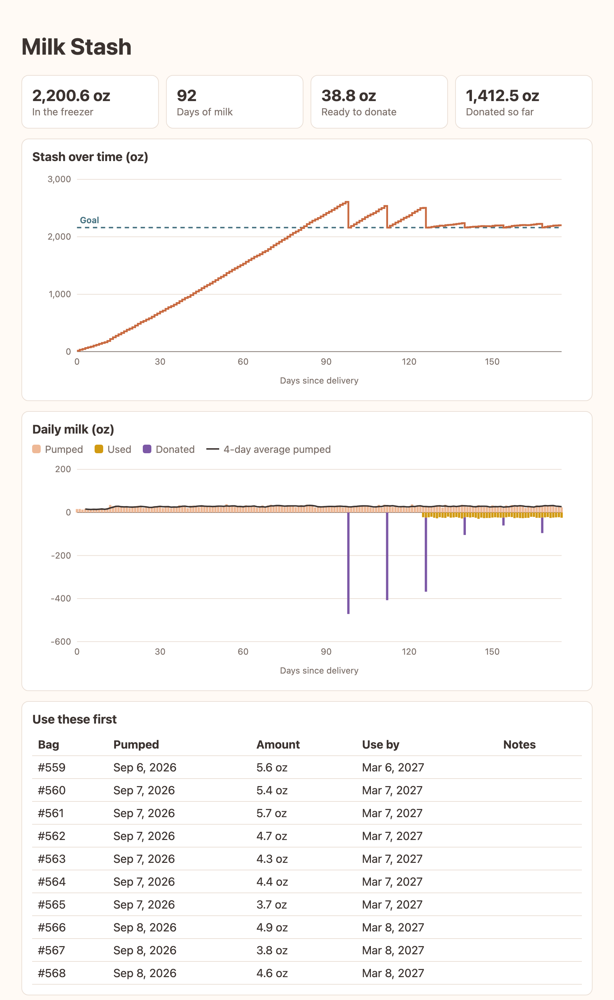

# Milk Stash

A small, friendly tracker for a frozen breast milk supply. It answers the three questions that come up at the freezer:

- **How much do we have?**
- **What's expiring, and what should we use first?**
- **How much can we donate and still keep enough for our baby?**

You choose your own goal. Keep three months of milk, two weeks, or anything else, and Milk Stash tells you which bags are extra.

It's one file with nothing to install beyond Python. Your data stays on your computer.

## Get started

1. Check that you have Python 3.8 or newer by running `python3 --version`. If you don't, [download it here](https://www.python.org/downloads/).
2. [Download `milkstash.py`](milkstash.py) (use the download button on that page).
3. Open a terminal in the folder where you saved it and run:

```
python3 milkstash.py
```

The first time, it asks a few quick questions and then shows a simple menu:

```
Your milk stash
--------------------------------------------
  In the freezer  2,736.7 oz in 583 bags
  Lasts about     114 days (24.0 oz a day)
  Your goal       2,160.0 oz (90 days)
  [####################] 127% of goal

  You can donate 120 bags (574.2 oz) and still meet your goal. See: plan

  1 Add milk      2 Use a bag     3 Donate extra
  4 See bags      5 Open report   6 Settings    q Quit
```

Want to look around first? `python3 milkstash.py demo` uses made-up data and doesn't touch your stash.

## Everyday use

The menu does everything, or you can type commands directly:

| To do this | Type |
| --- | --- |
| Add two bags from today | `python3 milkstash.py add 5 4.5` |
| Add a bag in ml from another day | `python3 milkstash.py add 150ml --date 3/14/2026` |
| See your stash | `python3 milkstash.py status` |
| Use the oldest bag | `python3 milkstash.py use` |
| See which bags are extra | `python3 milkstash.py plan` |
| Mark the extra bags as donated | `python3 milkstash.py donate` |
| Throw away bag 12 | `python3 milkstash.py toss 12` |
| Undo a change to bag 12 | `python3 milkstash.py restore 12` |
| Make a page with a chart | `python3 milkstash.py report` |

Each new bag gets a number. Write it on the bag so you can find it later.

## Your report

Run `python3 milkstash.py report` to open a page with your numbers and chart. This example uses made-up data:



- **Summary numbers** show what's in the freezer, how many days it will last, how much is ready to donate, and how much you've donated so far.
- **Stash over time** tracks your supply against your goal, shown as the dashed line. Each sharp drop in this example is a donation that brings the stash back down to the goal.
- **Daily milk** shows what you pumped each day above the line and what was used, donated, or tossed below it. The dark line is your 4-day pumping average, which makes trends easier to see.
- **Use these first** lists the 10 oldest in-date bags with their bag numbers and use-by dates.

Add your baby's birthday to count both charts in days since delivery. Without it, they show calendar months:

```
python3 milkstash.py settings --birth-date 3/14/2026
```

The report is saved on your computer and works in light or dark mode.

## Set your own goal

```
python3 milkstash.py settings --target-days 60 --daily-oz 20
```

| Setting | Starts at | Meaning |
| --- | --- | --- |
| `--target-days` | 90 | Days of milk to keep before anything counts as extra |
| `--daily-oz` | 24 | How much your baby drinks per day |
| `--freezer-months` | 6 | How long a frozen bag is good for |
| `--warn-days` | 30 | How early to warn about expiring bags |
| `--unit` | oz | Show amounts in `oz` or `ml` |
| `--birth-date` | not set | Baby's birthday, used for days since delivery on charts |

## How donation suggestions work

Milk Stash adds up your in-date bags and subtracts your goal. It then suggests the oldest whole bags that fit in the extra, so your freshest milk stays home and you never drop below your goal.

## Already keeping a spreadsheet?

Export it as a CSV and run:

```
python3 milkstash.py import my-log.csv
```

The file needs a `Date` column and a `Volume (ml)` or `Volume (oz)` column. Optional columns are `Name`, `Used`, `Donated`, `Donation date`, and `Special notes`. Spreadsheets rarely record when a bag was used, so imported used bags are counted on the day they were pumped.

## Where your data lives

Everything is in a `.milkstash` folder in your home directory. Your bags are in `stash.csv`, which opens in Excel, Numbers, or Google Sheets. Nothing is uploaded anywhere. To back up your stash, copy that folder.

## A note on safety

Milk Stash is a record-keeping tool and isn't medical advice. The 6-month default follows the [CDC's storage guidelines](https://www.cdc.gov/breastfeeding/pdf/humanmilk-en-5x7-508.pdf) that milk frozen at 0°F (-18°C) or colder is best within 6 months and acceptable for up to 12. Guidance can differ for premature or medically fragile babies, so check with your pediatrician or lactation consultant.

If you'd like to donate, contact an accredited milk bank first. In the US and Canada, you can [find one through HMBANA](https://www.hmbana.org/find-a-milk-bank/). Milk banks screen donors and have their own rules about milk age and storage, so ask before setting bags aside.

## License

MIT. Use it, share it, and change it however helps your family.
